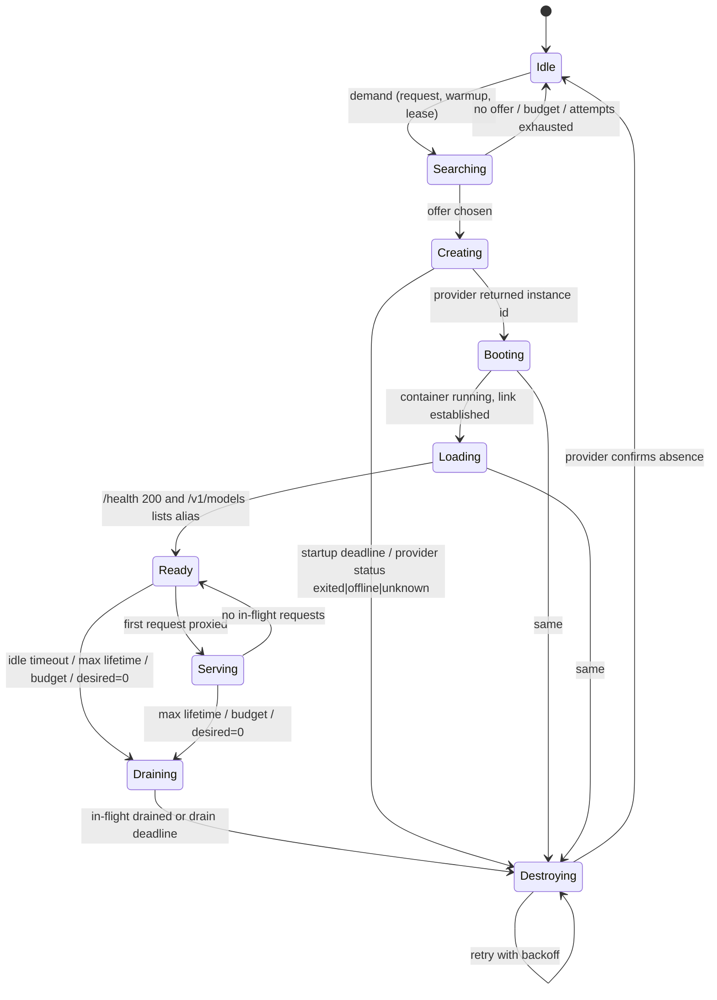

# ADR 0003: One binary owns the GPU lifecycle; instances are destroyed, never stopped

## Status

Accepted (2026-11-01).

## Context

The brief asks whether the gateway and the GPU lifecycle controller should be
separate Deployments or modules of one binary, requires scale-to-zero with a
20-minute idle timeout, a maximum of one instance, protection against
duplicate provisioning, orphan detection, and recovery after restarts.
Research shows that a stopped Vast.ai instance keeps paying storage, may
never be able to restart because the GPU was rented to someone else, and
that `exited`, `offline` and `unknown` instances never recover
([research §1.4–1.5](../research.md)).

## Decision

### 1. One binary, one Deployment

`gpu-on-demand` is a single Go binary with two internal packages,
`internal/gateway` and `internal/controller`, sharing one process, one
configuration and one state store (ADR 0004). It runs as one Deployment
with `replicas: 1` and `strategy: Recreate`. There is no inter-service API,
no second Secret, no second chart.

### 2. Desired state is zero or one instance

`gpu.maxInstances` is 1 in the MVP and the state machine assumes it. The
state of the single instance:

Each durable transition (into Searching's result, Creating, Booting, Loading,
Ready, Draining, Destroying, Idle, Failed) is one compare-and-swap on the
state document (ADR 0004). Ready ↔ Serving and the in-flight count are
process memory, because a write per request would cost more than it
protects; a restart simply re-probes health.

### 3. Identity and fencing

Every instance carries the provider label `vkllm:<installation-id>:<generation>`.
`installation-id` is the configured installation identity (ADR 0004 §6,
chart value `installationId`, default derived from namespace and release);
`generation` increments on every create. Two installations sharing one
provider account have different prefixes and never act on each other's
instances. A process may only destroy an
instance whose generation is less than or equal to the one it read from the
store, so a stale process that lost a CAS race cannot destroy a newer
instance.

### 4. Reconcile loop

Every `controller.reconcileInterval` (60 s) the controller calls
`ListInstances(labelPrefix = "vkllm:<installation-id>:")` and compares:

| Provider says | Store says | Action |
|---|---|---|
| instance with our label | unknown | **orphan**: destroy, count `vkllm_orphans_destroyed_total` |
| instance `exited`/`offline`/`unknown` | known | mark Failed, destroy, backoff |
| no instance | known as Ready/Serving | mark Lost, fail in-flight with 502, back to Idle |
| instance running | known | refresh observed fields |

The loop also applies idle timeout, max lifetime, budget (ADR 0007, spec
100) and the attempt budget.

### 5. Idle, lifetime and deadlines

- **Idle:** no in-flight requests, no unexpired workflow lease, and
  `now - max(lastRequestAt, readyAt) >= gpu.idleTimeout` (20 min) → Draining,
  so a slow warm-up still gets the full idle window.
- **Max lifetime** (`gpu.maxLifetime`, 6 h): Draining regardless of activity;
  a lease cannot extend past `maxLifetime + 30 min`.
- **Startup deadline** (`gpu.startupDeadline`, 15 min) from Creating to Ready;
  on expiry destroy, record the failure, and back off exponentially
  (1, 2, 4 … minutes, capped at 30).
- **Attempt budget** (`gpu.maxProvisionAttemptsPerHour`, 3): once exceeded the
  controller stays Idle and raises an alert instead of trying again.
- **Draining:** stop accepting new work for this instance; wait for in-flight
  requests up to `gpu.drainTimeout` (5 min); then destroy.

### 6. Destroy, never stop

The controller never calls the provider's stop endpoint. Teardown is always
`DestroyInstance`, retried with backoff until `GetInstance` reports the
instance gone or returns not-found. A destroy that keeps failing is a paged
alert, not a silent give-up.

### 7. Worker dead-man timer

The worker exits on its own when it has served no request for
`gpu.idleTimeout + 10 min` (spec 070). An exited instance stops GPU billing
even when the control plane is down, and the reconcile loop destroys it when
the control plane returns.

### 8. Restart recovery

On start the controller loads the state document, lists provider instances
by label, and converges: a Ready instance that still answers `/health` is
re-adopted and the link re-established; anything else follows the table in
§4. In-flight requests from before the restart are gone; clients see a
connection error and the SDK retries.

## Alternatives considered

- **Two Deployments** (gateway, controller). Clean on a diagram; in practice
  it adds a service-to-service API, a second authentication path, two
  rollouts and two sets of probes to protect one instance. Nothing in the
  MVP scales independently. Revisit when `maxInstances > 1` or when the
  gateway needs more than one replica for availability.
- **Stop instead of destroy to keep the model on disk.** Pays storage
  continuously and may never restart on the same GPU. Rejected; ADR 0005
  covers cold-start cost instead.
- **Kubernetes CRD + operator.** The right shape at a larger scale. A CRD
  with one allowed object is ceremony; recorded as a future step.
- **Kubernetes Lease for leader election.** Not needed at `replicas: 1` with
  `Recreate`; the CAS store already serialises writers. Upgrade path when
  replicas grow.

## Rationale

Every safety property needed here, no duplicate create, no orphan, no
unbounded retries, bounded idle cost, follows from three small rules: one
writer, label-based identity, and destroy-to-confirmation. Splitting the
binary would not strengthen any of them.

## Consequences

- A gateway rollout restarts the controller too; a 30-second drain and
  `Recreate` make that safe because the state is external.
- The gateway cannot be scaled horizontally without first adding leader
  election. Accepted for the MVP.
- Every idle timeout costs one cold start on the next request; the user
  accepted this for a 20-minute window.

## Risks

- A bug that marks a live instance as unknown would destroy it mid-request.
  Mitigation: the orphan rule only fires for labels whose generation is
  absent from the document *and* the document's current generation is
  higher; spec 050's simulation tests cover the race.
- The provider list call can lag or fail. Mitigation: a failed list never
  triggers destroys; only a successful list that omits a known instance does,
  and only after two consecutive observations.
