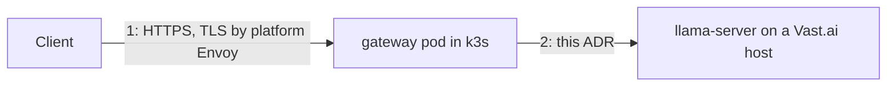

# ADR 0006: The controller reaches the worker through an SSH tunnel; llama-server never listens publicly

## Status

**Proposed** (2026-11-01). Becomes Accepted when spec 030 shows that the SSH
launch mode works with the `server-cuda` image and that SSE streams through
the tunnel at acceptable latency. Fallback B below is pre-approved if it
does not.

## Context

There are two network links:

Link 1 is the platform's: Envoy terminates TLS with the wildcard certificate
and routes `llm.<fqdn>` to the gateway Service. Link 2 crosses the public
internet to a rented container whose only exposure is a random external
port on a shared, often dynamic public IP, with no TLS, no privileged mode,
no TUN device, and full outbound internet ([research §1.6](../research.md)).
The cluster has no stable egress IP, so the worker cannot allow-list it.
Prompts and completions cross this link, so it must be encrypted and
authenticated in both directions.

## Decision

1. The instance is created in Vast's **SSH launch mode** with the official
   image. Vast adds the account's SSH public key to every instance. The
   `onstart` script downloads the model and starts `llama-server` bound to
   `127.0.0.1:8080` (ADR 0002).
2. The **controller** holds the matching private key (Secret `<release>-ssh`,
   key `id_ed25519`) and opens an SSH connection to `ssh_host:ssh_port` from
   the instance record using `golang.org/x/crypto/ssh`. All HTTP traffic to
   the worker, including `/health`, `/metrics` and completions, goes through
   a direct-tcpip channel to `127.0.0.1:8080`. One SSH connection is kept
   open per instance with keepalives; channels are multiplexed per request.
   The controller hands the gateway an `http.RoundTripper` over that channel
   once the instance is Ready (spec 050, ruling: the gateway never dials).
3. Host key policy: trust on first use per instance, pinned for that
   instance's lifetime in the state document. A changed host key for a known
   instance is a hard failure that destroys the instance.
4. llama-server additionally requires `--api-key` with a per-instance key
   passed through the provider environment, so a process on the same host
   cannot use the loopback port. The key is derived, not stored:
   `base64url(HMAC-SHA256(workerSeed, "worker:" + installationId + ":" + generation))`,
   where `workerSeed` is the `worker-seed` key of the `<release>-api-keys`
   Secret (ADR 0012 §3), so a restarted control plane can re-adopt a running
   instance without persisting the key anywhere, and rotating management
   tokens never forces a re-provision.
5. The controller dials only the `ssh_host`/`ssh_port` the provider API returned
   for the instance id it created. No address from configuration or request
   input is ever dialed. This is the SSRF boundary.
6. The link is behind a `Dialer` interface, owned by the controller
   (`internal/tunnel`, specified in spec 050): `Dial(ctx, Instance) (Conn, error)`,
   where `Conn` has `RoundTripper() http.RoundTripper`, `Close() error` and
   `HostKey() ssh.PublicKey`. Fallback B is a second `Dialer` implementation.

## Alternatives considered

- **B: TLS reverse proxy in a custom image on a mapped port.** Entrypoint
  mode keeps the official entrypoint; a sidecar process (Caddy or a small Go
  proxy) terminates TLS with a per-instance self-signed certificate whose
  fingerprint is passed back through the provider API or pinned by the
  controller, plus a bearer token. Works on any launch mode and does not
  depend on Vast's SSH injection. Costs an image build pipeline, CUDA base
  drift, and exposes an authenticated public port. Pre-approved fallback.
- **C: Worker dials out to the gateway.** A small agent in the worker opens
  an outbound connection to `llm.<fqdn>` (valid platform TLS) and the gateway
  multiplexes requests back over it (yamux or an SSH reverse tunnel). Immune
  to dynamic IPs and shared ports, needs no inbound exposure at all. Costs a
  custom image or a downloaded agent binary, a registration handshake, and
  the most new code. Recorded as the brief requires; revisit if a provider
  offers no inbound ports.
- **WireGuard or Tailscale.** No TUN device in unprivileged Vast containers;
  Tailscale userspace mode is possible but adds a control plane dependency
  and an account. Rejected.
- **Plain HTTP with an API key on the mapped port.** Prompts in cleartext on
  a shared IP. Rejected.
- **Vast's Cloudflare quick tunnels.** Best-effort, not guaranteed, and route
  prompts through a third party. Rejected.

## Rationale

SSH is already provisioned by the marketplace, authenticated with keys we
control, encrypted end to end, and needs no custom image. It gives the
security property the brief demands, no unprotected LLM endpoint, with the
least new machinery.

## Consequences

- Connectivity is a per-instance SSH session the **controller** manages:
  reconnect with backoff, treat repeated failure (`ReportUpstreamFailure`
  twice) as instance loss (ADR 0003 §4).
- Metrics from llama-server are pulled by the gateway over the tunnel and
  re-exported, not scraped by Prometheus directly.
- Throughput for a streaming completion is bounded by the SSH channel;
  spec 030 measures time-to-first-token and tokens-per-second through it.
- The worker needs the public key only; the private key never leaves the
  cluster.

## Risks

- Vast's SSH injection may not work in the `server-cuda` image, or may run
  through Vast's SSH proxy with different behaviour. Spec 030 is the gate;
  B is the answer if it fails.
- SSH proxy hosts could throttle long-lived channels. Measured in spec 030.
