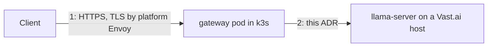

# ADR 0006: The controller reaches the worker through an SSH tunnel; llama-server never listens publicly

## Status

**Accepted (bundle A, SSH launch mode), with an amended G5 latency
threshold, by project-owner decision**, 2026-11-02, after two real runs of
spec [030](../../specs/core/030-D-worker-launch-spike/spec.md) against one
1×L40S Vast.ai instance each (research §7). SSH launch mode works with the
`server-cuda` image, with no manual step, in both runs (G1, G2, G4, G6 all
passed; G3 passed conclusively in one run and was inconclusive — not
failed — in the other, for lack of a confirming external scan).

**Amendment to the G5 latency gate (defined in spec 030, not in this
ADR) — this status's one caveat.** The 300 ms tunnel-vs-host TTFT cap that
gate proposed was **not met in either real run**: the measured delta was
804 ms (run 1) and 941 ms (run 2, slower still), against a cap of 300 ms.
Streamed tokens-per-second was essentially unaffected both times (≥ 99.6 %
of on-host speed; faster than on-host in one run). The project owner
reviewed this real data and **decided**, not the gate logic itself, to
accept bundle A anyway rather than build fallback B for a sub-second
latency difference with no throughput cost; building a custom image with
Caddy and TLS was judged not worth it for that gap. This is an **explicit,
informed amendment of the G5 threshold**, not a silent pass: a future
reader should not assume 300 ms was met.

**The amended G5 threshold, stated concretely: TTFT delta ≤ 1.0 s and
tokens/s ≥ 95 % of host.** This turns "sub-second latency difference with
no throughput cost" — the owner's own rationale above — into a testable
number; it is not an independently engineered figure. Both real samples
meet it (804 ms / 941 ms ≤ 1.0 s; 99.57 % / 100.66 % ≥ 95 %). Fallback B
remains pre-approved below: a future run measuring a TTFT delta over 1.0 s,
or tokens/s under 95 % of host, re-opens it.

Requesting Vast's `ssh_direct` runtype, in the one run that tried it, did
not change the SSH routing observed for that host — the script's own
direct/proxy test classified both runs as proxied. Whether a genuinely
direct connection exists, or would change the G5 numbers, is **unconfirmed**
by this evidence, not ruled out; see research §7.2 (Q3).

## Context

There are two network links:

Link 1 is the platform's: Envoy terminates TLS with the wildcard certificate
and routes `llm.<fqdn>` to the gateway Service. Link 2 crosses the public
internet to a rented container whose only exposure is a random external
port on a shared, often dynamic public IP, with no TLS, no privileged mode,
no TUN device, and full outbound internet ([research §1.6](../research.md)).
The cluster has no stable egress IP, so the worker cannot allow-list it.
Prompts and completions cross this link, so it must be encrypted and
authenticated in both directions.

## Decision

1. The instance is created in Vast's **SSH launch mode** with the official
   image. Vast adds the account's SSH public key to every instance. The
   `onstart` script downloads the model and starts `llama-server` bound to
   `127.0.0.1:8080` (ADR 0002).
2. The **controller** holds the matching private key (Secret `<release>-ssh`,
   key `id_ed25519`) and opens an SSH connection to `ssh_host:ssh_port` from
   the instance record using `golang.org/x/crypto/ssh`. All HTTP traffic to
   the worker, including `/health`, `/metrics` and completions, goes through
   a direct-tcpip channel to `127.0.0.1:8080`. One SSH connection is kept
   open per instance with keepalives; channels are multiplexed per request.
   The controller hands the gateway an `http.RoundTripper` over that channel
   once the instance is Ready (spec 050, ruling: the gateway never dials).
3. Host key policy: trust on first use per instance, pinned for that
   instance's lifetime in the state document. A changed host key for a known
   instance is a hard failure that destroys the instance.
4. llama-server additionally requires `--api-key` with a per-instance key
   passed through the provider environment, so a process on the same host
   cannot use the loopback port. The key is derived, not stored:
   `base64url(HMAC-SHA256(workerSeed, "worker:" + installationId + ":" + generation))`,
   where `workerSeed` is the `worker-seed` key of the `<release>-api-keys`
   Secret (ADR 0012 §3), so a restarted control plane can re-adopt a running
   instance without persisting the key anywhere, and rotating management
   tokens never forces a re-provision.
5. The controller dials only the `ssh_host`/`ssh_port` the provider API returned
   for the instance id it created. No address from configuration or request
   input is ever dialed. This is the SSRF boundary.
6. The link is behind a `Dialer` interface, owned by the controller
   (`internal/tunnel`, specified in spec 050): `Dial(ctx, Instance) (Conn, error)`,
   where `Conn` has `RoundTripper() http.RoundTripper`, `Close() error` and
   `HostKey() ssh.PublicKey`. Fallback B is a second `Dialer` implementation.

## Alternatives considered

- **B: TLS reverse proxy in a custom image on a mapped port.** Entrypoint
  mode keeps the official entrypoint; a sidecar process (Caddy or a small Go
  proxy) terminates TLS with a per-instance self-signed certificate whose
  fingerprint is passed back through the provider API or pinned by the
  controller, plus a bearer token. Works on any launch mode and does not
  depend on Vast's SSH injection. Costs an image build pipeline, CUDA base
  drift, and exposes an authenticated public port. Pre-approved fallback.
- **C: Worker dials out to the gateway.** A small agent in the worker opens
  an outbound connection to `llm.<fqdn>` (valid platform TLS) and the gateway
  multiplexes requests back over it (yamux or an SSH reverse tunnel). Immune
  to dynamic IPs and shared ports, needs no inbound exposure at all. Costs a
  custom image or a downloaded agent binary, a registration handshake, and
  the most new code. Recorded as the brief requires; revisit if a provider
  offers no inbound ports.
- **WireGuard or Tailscale.** No TUN device in unprivileged Vast containers;
  Tailscale userspace mode is possible but adds a control plane dependency
  and an account. Rejected.
- **Plain HTTP with an API key on the mapped port.** Prompts in cleartext on
  a shared IP. Rejected.
- **Vast's Cloudflare quick tunnels.** Best-effort, not guaranteed, and route
  prompts through a third party. Rejected.

## Rationale

SSH is already provisioned by the marketplace, authenticated with keys we
control, encrypted end to end, and needs no custom image. It gives the
security property the brief demands, no unprotected LLM endpoint, with the
least new machinery.

## Consequences

- Connectivity is a per-instance SSH session the **controller** manages:
  reconnect with backoff, treat repeated failure (`ReportUpstreamFailure`
  twice) as instance loss (ADR 0003 §4).
- Metrics from llama-server are pulled by the gateway over the tunnel and
  re-exported, not scraped by Prometheus directly.
- Throughput for a streaming completion is bounded by the SSH channel;
  spec 030 measured time-to-first-token and tokens-per-second through it
  (research §7.2 Q10): tokens-per-second close to on-host speed, TTFT
  roughly 0.8–0.94 s slower than on-host (804 ms, 941 ms).
- The worker needs the public key only; the private key never leaves the
  cluster.

## Risks

- Vast's SSH injection may not work in the `server-cuda` image, or may run
  through Vast's SSH proxy with different behaviour. Spec 030 is the gate;
  B is the answer if it fails. **Resolved for bundle A**: both real runs
  were proxied (research §7.2 Q3), and the SSH injection itself worked via
  a derived-image build both times (research §7.1).
- SSH proxy hosts could throttle long-lived channels. **Measured in spec
  030**: 0 channel drops in both runs, but a bulk transfer over a plain
  SSH exec channel (a separate session, not the forwarded HTTP tunnel
  channel) measured only 1.6–2.2 MB/s — well under the host's own HF
  fetch-only throughput (66.9–99.7 MB/s) — while interactive streaming
  through the actual tunnel (TTFT, tokens/s) was close to on-host speed.
  The proxy appears to throttle sustained bulk transfer specifically, not
  interactive completions; research §7.2 (Q3) and §7.4 (M8) have the
  numbers.
