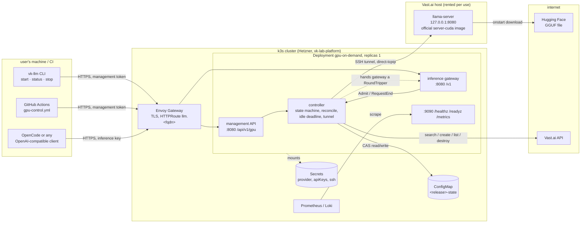
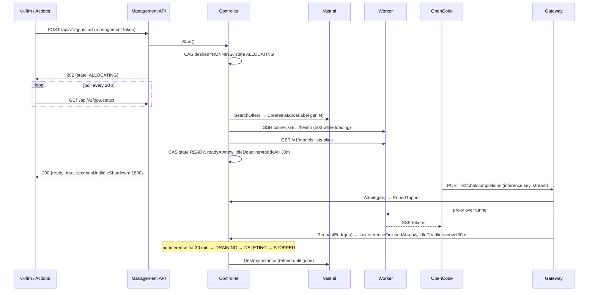
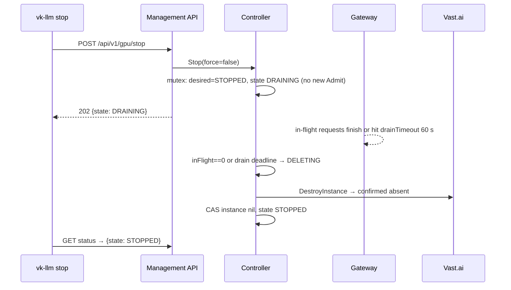
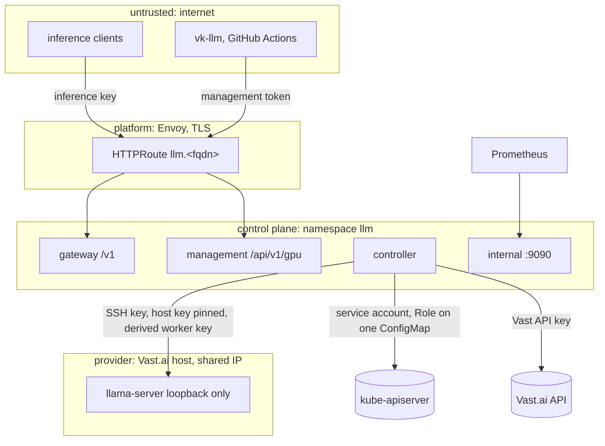

# Architecture

Target architecture for the initial release (P0 + P1). Decisions are in
[`adr/`](adr/); this document shows how they fit. Facts marked with a
source tag come from [`research.md`](research.md).

## 1. Shape

One binary, one process, three internal HTTP surfaces (ADR 0003, 0012).
The GPU is started explicitly and stopped by a 30-minute rolling
inactivity timeout or a manual stop (ADR 0010, 0011). The worker is a
provider instance, not a cluster node (ADR 0001). The only durable state is
one ConfigMap (ADR 0004). The controller reaches the worker through an
SSH tunnel and hands the gateway a transport (ADR 0006, Accepted (bundle
A, SSH), with an amended G5 latency threshold).

## 2. Components

| Component | Package | Responsibility | Depends on |
|---|---|---|---|
| Management API | `internal/mgmt` | `/api/v1/gpu/{start,status,stop,cost}`; management-token auth; idempotent start/stop; status document (ADR 0012 §1) | controller (`Start`, `Stop`, `Status`), budget |
| Inference gateway | `internal/gateway` | OpenAI-compatible `/v1/chat/completions` and `/v1/models`; inference-key auth; body, token and rate limits; SSE pass-through with cancellation; `backend_unavailable` in explicit mode (ADR 0010 §2) | controller (`Admit`, `RequestEnd`, `ObserveFirstToken`, `ReportUpstreamFailure`) |
| Controller | `internal/controller` | desired-state reconciliation, GPU state machine, provisioning saga, rolling idle deadline and immediate stop (ADR 0011), reconcile loop, orphan sweep, restart recovery, tunnel session owner (ADR 0003, 0006) | provider, store, tunnel, budget, clock |
| Provider | `internal/provider` (`vastai`, `fake`) | the six-method `Provider` interface (ADR 0001); offer filter; 429 backoff | HTTP, config |
| Store | `internal/store` (`configmap`, `fake`) | `Load`/`Save` with optimistic concurrency, `Transition` helper, schema upgrades (ADR 0004) | Kubernetes API via service account |
| Tunnel | `internal/tunnel` (`ssh`, `direct`) | `Dialer` yielding a `Conn` (round tripper, host key, close); keepalive; host-key pinning; held by the controller (ADR 0006) | `golang.org/x/crypto/ssh` |
| Worker | `internal/worker` | embedded `onstart` script, environment contract, readiness client, metrics pull (ADR 0002, 0005) | tunnel |
| Auth | `internal/auth` | loads `client-keys`, `management-tokens`, `worker-seed` from the mounted Secret with hot reload; constant-time `Classify` into inference / management / none; per-key token bucket; shared by the gateway and the management API (specified in spec 060) | Secret files |
| Budget | `internal/budget` | ledger, month rollover, `Allow`, price assertion (spec 100) | store document |
| Config | `internal/config` | typed configuration from environment and mounted files; defaults in §9 | — |
| Clock | `internal/clock` (`fake`) | time source for every timer and deadline | — |
| Observability | `internal/obs` | Prometheus registry, slog JSON handler, request id, redaction | `prometheus/client_golang` |
| CLI | `cmd/vk-llm` | thin client of the management API (ADR 0012 §4) | stdlib `flag`, `gopkg.in/yaml.v3` |

Interfaces exist exactly where a second implementation or a test fake
exists: `Provider`, `Store`, `Dialer`, `Clock`.

## 3. Lifecycle flows

### 3.1 Start, use, idle out

### 3.2 Manual stop

A request arriving after the mutex transition receives `backend_unavailable`
(ADR 0011 §4). A request admitted before it is drained.

## 4. GPU state machine

```mermaid
stateDiagram-v2
    [*] --> STOPPED
    STOPPED --> ALLOCATING: start (desired=RUNNING)
    ALLOCATING --> STARTING: instance id
    ALLOCATING --> STOPPED: no offer / budget / attempts (reason recorded)
    STARTING --> LOADING_MODEL: tunnel up, health 503
    LOADING_MODEL --> READY: health 200 + alias listed; readyAt set
    READY --> READY: inference (inFlight>0 blocks idle; RequestEnd moves idleDeadline)
    READY --> DRAINING: idleDeadline reached / stop / maxLifetime / budget
    ALLOCATING --> DELETING: stop (as soon as an id exists)
    STARTING --> DELETING: stop / startupTimeout / provider failure
    LOADING_MODEL --> DELETING: stop / startupTimeout / provider failure
    DRAINING --> DELETING: inFlight 0 or drainTimeout 60 s
    DELETING --> STOPPED: provider confirms absence
    DELETING --> DELETING: destroy retried with backoff
    DELETING --> ALLOCATING: desired=RUNNING recorded during drain
```

`FAILED` is reported in status while a terminal provider status or a
startup timeout is being cleaned up; it resolves to `STOPPED` when the
destroy confirms. Controller-internal stages (Searching, Creating,
Booting, Serving) map to these public states per ADR 0011 §6.

Rules: one writer via store CAS; identity by label
`vkllm:<installationId>:<generation>`; reconcile every 60 s against
`ListInstances`; unknown label → destroy; `exited|offline|unknown` →
destroy and back off; destroy retried until confirmed; never stop
(ADR 0003); the worker exits itself after `idleShutdown.timeout + 10m`
without traffic.

Cold-start stages are timed and exported as
`vkllm_coldstart_stage_seconds{stage}` with stages `search`, `create`,
`boot`, `link`, `download`, `load`, `ready`, `first_token`.

## 5. Data ownership

| Data | Owner | Where | Lifetime |
|---|---|---|---|
| `desired` (RUNNING/STOPPED), observed instance, generation, `readyAt`, `lastInferenceFinishedAt`, `idleDeadline`, ops, month ledger, machine denylist | controller | ConfigMap `<release>-state` | release lifetime; instance rebuilt from provider labels on loss |
| In-flight request count | controller (mutex) | process memory | process lifetime |
| Instance reality | provider | Vast.ai | until destroyed |
| Model weights | worker | instance ephemeral disk (P2: persistent volume, ADR 0014) | instance lifetime |
| Secrets | operator / platform | Kubernetes Secrets (ADR 0009) | rotated by operator |
| CLI configuration | user | `~/.config/vk-llm/config.yaml`, environment | user's machine; never a token in the file |
| Metrics history | Prometheus | platform | platform retention |

## 6. Network and trust boundaries

- Inference keys and management tokens are separate lists in one Secret;
  each is rejected on the other surface (ADR 0012 §3).
- Port 9090 is never routed by Envoy.
- The controller dials only addresses returned by the provider API for an
  instance it created, and hands the gateway a ready-made transport; the
  gateway never dials anything itself (SSRF boundary, ADR 0006).
- The worker has no cluster credentials and no inbound port besides SSH.
- Request body limit 1 MiB; `max_tokens` capped; per-key rate limit on
  both surfaces.
- Everything in Git is public: no secret, domain or token ever appears in
  code, values, examples, fixtures or CI logs (ADR 0013).

## 7. Concurrency model

- One process; the controller runs one goroutine for the state machine
  (event-driven), one ticker for reconcile, and one timer armed at the idle
  deadline. All durable changes go through `store.Transition`.
- `Admit` and the transitions into `DRAINING` share one mutex over
  `(state, inFlight)` (ADR 0011 §4).
- Management calls are idempotent and serialized through the same state
  machine; repeated start/stop return the current state.
- Provider calls carry contexts with timeouts (search 30 s, create 60 s,
  get/list 15 s, destroy 30 s) and a 429 backoff with jitter (V).
- Shutdown of the pod: stop accepting, drain in-flight up to 30 s, close
  tunnels, exit. The GPU instance is **not** destroyed on pod shutdown;
  the next process re-adopts it and the persisted deadline still applies.

## 8. Failure handling summary

| Failure | Detection | Response |
|---|---|---|
| Vast API down or 5xx | provider errors | retry with backoff; never destroy on a failed list; alert after 5 min |
| No qualifying offer | empty search | state STOPPED with `unavailable: no_offer`; start returns 503; next start retries |
| Image pull or model download slow | stage timer | `startupTimeout` → destroy, exclude `machineId` for 1 h, backoff |
| Checksum mismatch | onstart exits non-zero | instance `exited` → destroy, alert |
| Worker crash mid-request | tunnel error / health 5xx | in-flight get `502`; instance destroyed; status shows STOPPED |
| Control plane restart | — | re-adopt Ready instance via label and health; idle deadline recomputed from persisted timestamps; in-flight lost (client retries) |
| Control plane restart after the deadline passed | tick | DRAINING at once |
| Control plane gone for long | worker dead-man timer | worker exits; billing stops; reconcile destroys on return |
| Stop during provisioning | desired=STOPPED | destroy as soon as an id exists; status DELETING then STOPPED |
| Start during draining | desired=RUNNING recorded | new generation after the destroy confirms |
| Budget reached | ledger ≥ `budget.monthlyUSD` | no new provisioning; running instance drained and destroyed |
| Store conflict | 409 | re-read, re-apply, bounded retries |
| Orphan instance | label unknown to store | destroy, metric, alert |
| Lost provider response on create | op recorded before the call | list by exact label; adopt or retry (spec 020) |

## 9. Configuration

All keys have environment-variable forms (`VKLLM_LIFECYCLE_IDLE_SHUTDOWN_TIMEOUT`)
and are set by the chart under `config.*`.

| Key | Default | Note |
|---|---|---|
| `installationId` | derived | sha256(namespace/release)[:12] unless set |
| `provider.name` | `vastai` | `fake` for tests |
| `provider.filter.gpuName` | `L40S` | |
| `provider.filter.numGpus` | 1 | |
| `provider.filter.minCpuCores` | 8 | |
| `provider.filter.minCpuRamGB` | 32 | |
| `provider.filter.minDiskGB` | 60 | |
| `provider.filter.minReliability` | 0.95 | |
| `provider.filter.minInetDownMBps` | 500 | unit verified in spec 020 |
| `provider.filter.minDiskBwMBps` | 500 | |
| `provider.filter.minCudaVersion` | 12.8 | image requirement |
| `provider.filter.geolocation` | `""` | optional country list |
| `lifecycle.provisioningMode` | `explicit` | `on-demand` future (ADR 0010) |
| `lifecycle.idleShutdown.enabled` | true | `false` refused unless `maxLifetime` set |
| `lifecycle.idleShutdown.timeout` | **30m** | rolling, from readiness and last inference end (ADR 0011) |
| `lifecycle.shutdown.policy` | `destroy-compute` | the only MVP policy |
| `lifecycle.shutdown.drainTimeout` | 60s | manual stop, lifetime, budget drains |
| `lifecycle.shutdown.allowForce` | false | `force` on stop (future) |
| `lifecycle.startupTimeout` | 15m | create → READY |
| `lifecycle.safety.maxInstances` | 1 | |
| `lifecycle.safety.maxHourlyPriceUSD` | 0.80 | |
| `lifecycle.safety.maxLifetime` | 12h | safeguard, not the idle rule |
| `lifecycle.safety.maxInstanceSpendUSD` | 0 | 0 = off |
| `lifecycle.safety.maxProvisionAttemptsPerHour` | 3 | |
| `budget.monthlyUSD` | 30 | |
| `budget.warnFraction` | 0.8 | |
| `controller.reconcileInterval` | 60s | |
| `gateway.maxBodyBytes` | 1048576 | |
| `gateway.maxTokensCap` | 8192 | |
| `gateway.rateLimitPerKeyRPM` | 60 | inference keys and management tokens alike |
| `onDemand.maxWait` / `onDemand.maxPending` / `onDemand.heartbeatInterval` | 480s / 32 / 15s | on-demand mode only (ADR 0007), not rendered by the MVP chart |
| `model.alias` | `qwen3.6-35b-a3b` | |
| `model.url` / `model.sha256` | pinned in chart | |
| `model.contextSize` / `model.parallel` | 32768 / 1 | |
| `model.generationTimeout` | 10m | upstream deadline per request |
| `worker.image` | `ghcr.io/ggml-org/llama.cpp:server-cuda@sha256:…` | pinned |
| `worker.deadManTimeout` | idleShutdown.timeout + 10m | |
| `tunnel.dialer` | `ssh` | `direct` only for the kind job with the fake worker |
| `tunnel.directAddr` | `""` | host:port of the fake worker when `direct` |
| `storage.*` | — | P2, ADR 0014; not rendered by the MVP chart |

## 10. Observability

Metrics prefix `vkllm_`. Labels are bounded enumerations only (state,
stage, outcome, code, reason); never request ids, key ids or instance ids.
New with this update: `vkllm_gpu_idle_deadline_seconds`,
`vkllm_gpu_last_inference_finished_seconds`,
`vkllm_shutdowns_total{reason=idle|manual|lifetime|budget|failure|orphan}`,
`vkllm_mgmt_requests_total{op,code}`. Logs are JSON via `slog` with
`request_id`, `instance_gen`, `state`, `stage`; no prompts, completions or
credentials. Spec 090 holds the catalog, the dashboard and the four
alerts.

## 11. Deployment

One Helm chart, `gpu-on-demand`, on GHCR (ADR 0008). On the platform the
chart is pulled by an Argo `Application` from this repository's `gitops/`
chart, which the platform's pointer `Application` renders (spec 130).
Anywhere else: `helm install` plus three Secrets. The `vk-llm` CLI is a
separate binary from GitHub Releases (ADR 0013). The GitHub Actions
workflow lives in this repository and needs one secret and one variable
(ADR 0012 §5).

## 12. Decision summary

| # | Decision | Status |
|---|---|---|
| [0001](adr/0001-external-gpu-workers.md) | External provider instances, six-method `Provider` | Accepted |
| [0002](adr/0002-llama-cpp-runtime.md) | Official llama-server image, pinned Qwen3.6 Q5_K_M | Accepted |
| [0003](adr/0003-gpu-lifecycle-management.md) | One binary; destroy, never stop; label identity; reconcile | Accepted, §5 amended by 0011 |
| [0004](adr/0004-state-persistence.md) | One ConfigMap with optimistic concurrency | Accepted, fields amended by 0011 |
| [0005](adr/0005-model-storage.md) | Download from Hugging Face per provision | Accepted; P2 cache in 0014 |
| [0006](adr/0006-worker-connectivity.md) | Controller-owned SSH tunnel to loopback llama-server | Accepted (bundle A, SSH), with an amended G5 latency threshold |
| [0007](adr/0007-cold-start-api-strategy.md) | Bounded wait with heartbeats | Future on-demand mode only |
| [0008](adr/0008-release-pipeline-and-chart.md) | vk-ahorro pipeline and chart conventions | Accepted, extended by 0013 |
| [0009](adr/0009-secrets-and-api-keys.md) | Secrets by name; platform KMS → SSM → ESO | Proposed (spec 130) |
| [0010](adr/0010-explicit-provisioning-mode.md) | Explicit provisioning is the MVP; `backend_unavailable` | Accepted |
| [0011](adr/0011-rolling-inactivity-timeout.md) | 30-minute rolling idle, immediate stop, no leases | Accepted |
| [0012](adr/0012-management-api-cli-and-github-actions.md) | Management API, `vk-llm`, GitHub Actions thin clients | Accepted |
| [0013](adr/0013-public-repo-security-and-cli-release.md) | Scanning in CI, SECURITY.md, GoReleaser CLI release | Accepted |
| [0014](adr/0014-persistent-volume-cache-and-preferred-host.md) | P2 persistent-volume cache, preferred host | Proposed, P2 |

## 13. Unresolved

See [`open-questions.md`](open-questions.md).
