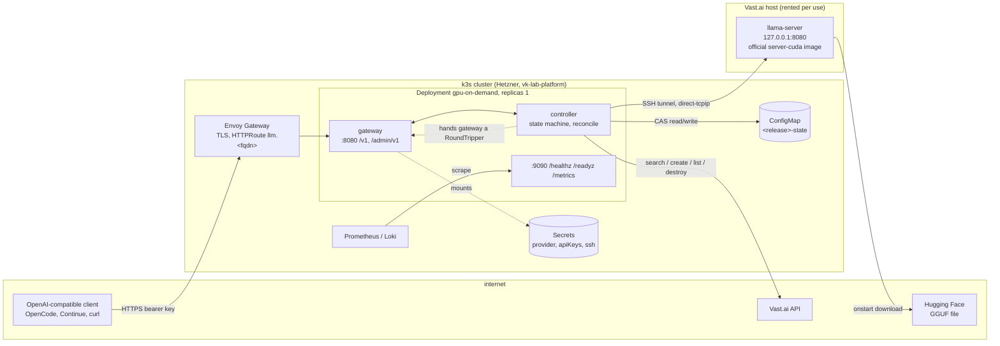
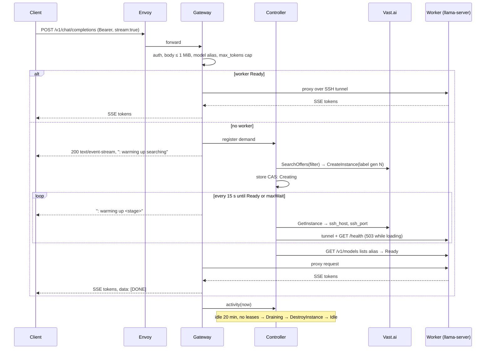
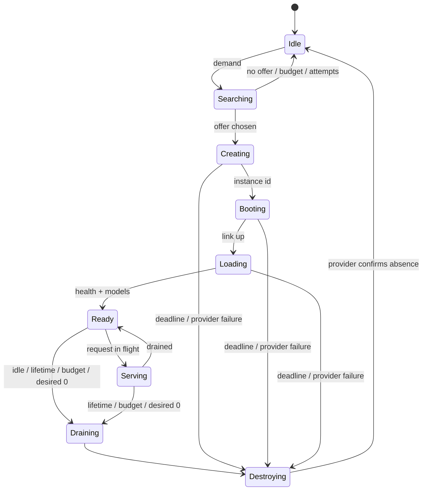
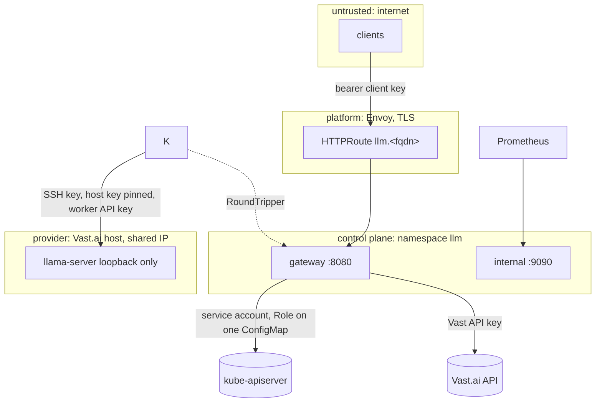

# Architecture

Target architecture for the MVP. Decisions are in [`adr/`](adr/); this
document shows how they fit. Facts marked with a source tag come from
[`research.md`](research.md).

## 1. Shape

One binary, one process, two internal packages (ADR 0003). The worker is a
provider instance, not a cluster node (ADR 0001). The only durable state is
one ConfigMap (ADR 0004). The worker is reached through an SSH tunnel
(ADR 0006, Proposed).

## 2. Components

| Component | Package | Responsibility | Depends on |
|---|---|---|---|
| Gateway | `internal/gateway` | OpenAI-compatible HTTP API, bearer auth, request limits, pending queue and cold-start wait (ADR 0007), SSE proxy with cancellation, admin API, graceful shutdown | controller (demand, readiness, and the `RoundTripper` it hands back in `Ready`) |
| Controller | `internal/controller` | GPU state machine, provisioning saga, reconcile loop, idle/lifetime/budget enforcement, orphan sweep, restart recovery (ADR 0003); owns the tunnel session for the live instance | provider, store, tunnel, clock |
| Provider | `internal/provider` (`vastai`, `fake`) | the six-method `Provider` interface (ADR 0001); offer filter; 429 backoff | HTTP, config |
| Store | `internal/store` (`configmap`, `fake`) | `Load`/`Save` with optimistic concurrency, `Transition` helper, schema upgrades (ADR 0004) | Kubernetes API via service account |
| Tunnel | `internal/tunnel` (`ssh`, `direct`) | `Dialer` that yields a `Conn` (round tripper, host key, close) to a worker; keepalive; host-key pinning; owned and held by the controller (ADR 0006, spec 050) | `golang.org/x/crypto/ssh` |
| Worker | `internal/worker` | embedded `onstart` script template, environment contract, readiness client (`/health` then `/v1/models`), metrics pull (ADR 0002, 0005) | tunnel |
| Config | `internal/config` | typed configuration from environment variables and mounted files; validation; defaults table below | — |
| Clock | `internal/clock` (`fake`) | time source for every timer and deadline; the fake drives simulations | — |
| Observability | `internal/obs` | Prometheus registry, slog JSON handler, request id middleware, redaction | `prometheus/client_golang` |

Interfaces exist exactly where a second implementation or a test fake
exists: `Provider`, `Store`, `Dialer`, `Clock`. Nothing else is abstracted.

## 3. Request lifecycle

Non-streaming requests follow the same path without heartbeats; on `maxWait`
they get `503` + `Retry-After: 30`. Client disconnect cancels the upstream
request through context propagation; llama-server cancels generation on
disconnect (V).

## 4. GPU lifecycle

Rules, all from ADR 0003: one writer via store CAS; identity by label
`vkllm:<installation-id>:<generation>`; reconcile every 60 s against
`ListInstances`; unknown label → destroy; `exited|offline|unknown` → destroy
and back off; destroy retried until confirmed; never stop; the worker exits
itself after `idleTimeout + 10 min` without traffic.

Cold-start stages are timed separately and exported as
`vkllm_coldstart_stage_seconds{stage}` with stages `search`, `create`,
`boot`, `link`, `download`, `load`, `ready`, `first_token`.

## 5. Data ownership

| Data | Owner | Where | Lifetime |
|---|---|---|---|
| Desired and observed instance, generation, ops, activity, leases, month ledger | controller | ConfigMap `<release>-state` | release lifetime; rebuilt from provider labels on loss |
| In-flight request set, pending queue | gateway | process memory | process lifetime |
| Instance reality | provider | Vast.ai | until destroyed |
| Model weights | worker | instance ephemeral disk | instance lifetime |
| Secrets | operator / platform | Kubernetes Secrets (ADR 0009) | rotated by operator |
| Metrics history | Prometheus | platform | platform retention |

## 6. Network and trust boundaries

- Client keys are validated in the gateway with constant-time compare;
  Envoy policies are optional extras (ADR 0009).
- Port 9090 is never routed by Envoy; it serves health and metrics inside
  the cluster only.
- The controller dials only addresses returned by the provider API for an
  instance it created, and hands the gateway a ready-made transport; the
  gateway never dials anything itself (SSRF boundary, ADR 0006).
- The worker has no cluster credentials and no inbound port besides SSH.
- Request body limit 1 MiB; `max_tokens` capped by configuration; per-key
  token bucket.

## 7. Concurrency model

- One process; the controller runs one goroutine for the state machine
  (event-driven) and one ticker for reconcile. All state changes go through
  `store.Transition`, so two goroutines cannot interleave a transition.
- The gateway serves requests on the standard `net/http` pool; the pending
  queue is a bounded channel-backed list with per-request contexts.
- Provider calls carry contexts with timeouts (search 30 s, create 60 s,
  get/list 15 s, destroy 30 s) and a 429 backoff with jitter because Vast
  returns no `Retry-After` (V).
- Shutdown: stop accepting, drain in-flight up to 30 s, close tunnels, exit.
  The instance is **not** destroyed on process shutdown; the next process
  re-adopts it.

## 8. Failure handling summary

| Failure | Detection | Response |
|---|---|---|
| Vast API down or 5xx | provider errors | retry with backoff; never destroy on a failed list; alert after 5 min |
| No qualifying offer | empty search | stay Idle, `503 gpu_unavailable`, retry search on next demand with backoff |
| Image pull or model download slow | stage timer | `startupDeadline` → destroy, exclude `machine_id` for 1 h, backoff |
| Checksum mismatch | onstart exits non-zero | instance `exited` → destroy, alert |
| Worker crash mid-request | tunnel error / health 5xx | in-flight get `502`; instance destroyed; next demand re-provisions |
| Control plane restart | — | re-adopt Ready instance via label and health; in-flight lost (SDK retries) |
| Control plane gone for long | worker dead-man timer | worker exits; billing stops; reconcile destroys on return |
| Budget reached | ledger ≥ `budget.monthlyUSD` | no new provisioning; running instance drained and destroyed |
| Store conflict | 409 | re-read, re-apply, bounded retries |
| Orphan instance | label unknown to store | destroy, metric, alert |

## 9. Configuration

All keys have environment-variable forms (`VKLLM_GPU_IDLE_TIMEOUT`) and are
set by the chart. Defaults are the user's choices.

| Key | Default | Note |
|---|---|---|
| `provider.name` | `vastai` | `fake` for tests |
| `provider.filter.gpuName` | `L40S` | |
| `provider.filter.numGpus` | 1 | |
| `provider.filter.minCpuCores` | 8 | |
| `provider.filter.minCpuRamGB` | 32 | |
| `provider.filter.minDiskGB` | 60 | |
| `provider.filter.minReliability` | 0.95 | |
| `provider.filter.minInetDownMBps` | 500 | unit verified in spec 020 |
| `provider.filter.minDiskBwMBps` | 500 | |
| `provider.filter.minCudaVersion` | 12.8 | image requirement |
| `provider.filter.geolocation` | `""` | optional country list |
| `gpu.maxHourlyPriceUSD` | 0.80 | |
| `gpu.minInstances` / `gpu.maxInstances` | 0 / 1 | |
| `gpu.idleTimeout` | 20m | |
| `gpu.startupDeadline` | 15m | |
| `gpu.maxLifetime` | 6h | |
| `gpu.drainTimeout` | 5m | |
| `gpu.maxProvisionAttemptsPerHour` | 3 | |
| `budget.monthlyUSD` | 30 | |
| `budget.warnFraction` | 0.8 | |
| `controller.reconcileInterval` | 60s | |
| `gateway.maxWait` | 480s | |
| `gateway.maxPending` | 32 | |
| `gateway.maxBodyBytes` | 1048576 | |
| `gateway.maxTokensCap` | 8192 | |
| `gateway.rateLimitPerKeyRPM` | 60 | |
| `gateway.heartbeatInterval` | 15s | |
| `model.alias` | `qwen3.6-35b-a3b` | |
| `model.url` / `model.sha256` | pinned in chart | |
| `model.contextSize` / `model.parallel` | 32768 / 1 | |
| `model.generationTimeout` | 10m | upstream deadline after the wait |
| `installationId` | derived | sha256(namespace/release)[:12] unless set |
| `worker.image` | `ghcr.io/ggml-org/llama.cpp:server-cuda@sha256:…` | pinned |
| `worker.deadManTimeout` | idleTimeout + 10m | |
| `tunnel.dialer` | `ssh` | `direct` only for the kind job with the fake worker |
| `tunnel.directAddr` | `""` | host:port of the fake worker when `direct` |

## 10. Observability

Metrics prefix `vkllm_`. Labels are bounded enumerations only (state,
stage, outcome, code); never request ids, key ids or instance ids. Logs are
JSON via `slog` with `request_id`, `instance_gen`, `state`, `stage`; no
prompts, completions or credentials. Spec 090 holds the catalog, the
dashboard and the four alerts.

## 11. Deployment

One Helm chart, `gpu-on-demand`, on GHCR (ADR 0008). On the platform the
chart is pulled by an Argo `Application` from this repository's `gitops/`
chart, which the platform's pointer `Application` renders (spec 130).
Anywhere else: `helm install` plus three Secrets.

## 12. Decision summary

| # | Decision | Status |
|---|---|---|
| [0001](adr/0001-external-gpu-workers.md) | External provider instances, six-method `Provider` | Accepted |
| [0002](adr/0002-llama-cpp-runtime.md) | Official llama-server image, pinned Qwen3.6 Q5_K_M | Accepted |
| [0003](adr/0003-gpu-lifecycle-management.md) | One binary; destroy, never stop; label identity; reconcile | Accepted |
| [0004](adr/0004-state-persistence.md) | One ConfigMap with optimistic concurrency | Accepted |
| [0005](adr/0005-model-storage.md) | Download from Hugging Face per provision | Accepted |
| [0006](adr/0006-worker-connectivity.md) | SSH tunnel to loopback llama-server | Proposed (spec 030) |
| [0007](adr/0007-cold-start-api-strategy.md) | Bounded wait with SSE heartbeats; admin warm-up API | Accepted |
| [0008](adr/0008-release-pipeline-and-chart.md) | vk-ahorro pipeline and chart conventions | Accepted |
| [0009](adr/0009-secrets-and-api-keys.md) | Secrets by name; platform KMS → SSM → ESO | Proposed (spec 130) |

## 13. Unresolved

See [`open-questions.md`](open-questions.md).
